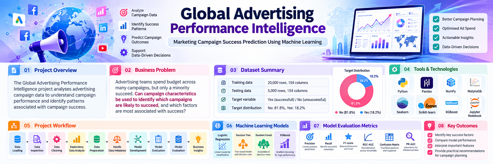
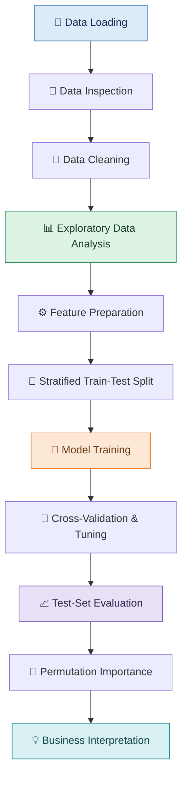
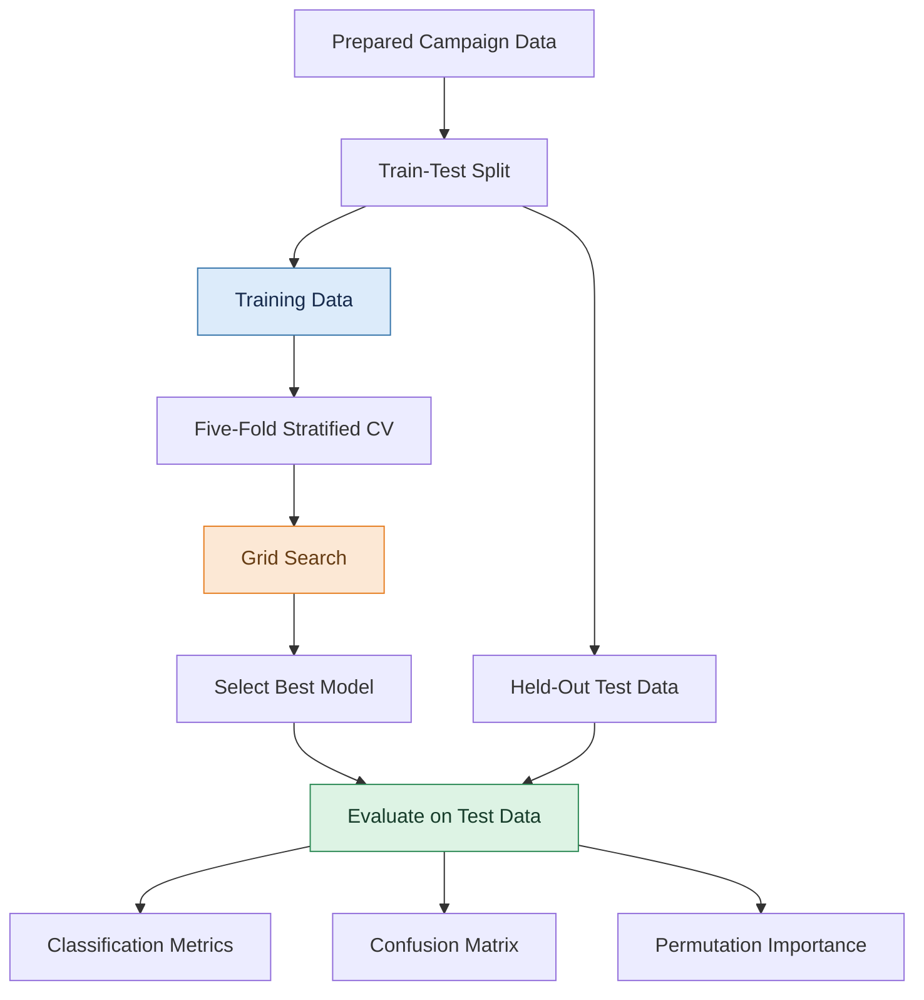

<p align="center">
  
</p>

# 📊 Global Advertising Performance Intelligence

<p align="center">
  <strong>Marketing Campaign Success Prediction Using Machine Learning</strong>
</p>

<p align="left">
  
  
  
  
  
  
  
</p>

An end-to-end machine learning project that analyses advertising campaign data to explore campaign performance, identify patterns associated with campaign success, and predict campaign outcomes using supervised classification models.

---

## 📌 Project Overview

The **Global Advertising Performance Intelligence** project investigates how advertising campaign characteristics relate to campaign success.

Using Python, data analysis, and machine learning, the project performs exploratory data analysis, preprocesses numerical and categorical features, compares classification algorithms, tunes model hyperparameters, and evaluates a selected model on an unseen test set.

## 🎯 Business Problem

Advertising teams allocate budgets across different platforms, campaign strategies, objectives, industries, and audience segments. Understanding which characteristics are associated with successful campaigns can help teams evaluate campaign plans more systematically.

This project investigates:

> Can campaign characteristics be used to predict which campaigns are likely to succeed, and which features contribute most to the model's predictions?

The goal is to evaluate the predictive value of campaign data and derive insights that may support data-informed advertising decisions.

## 🚀 Project Objectives

- Explore advertising campaign data and identify meaningful patterns.
- Check data quality, missing values, and duplicate records.
- Analyse campaign success rates and feature relationships.
- Prepare numerical and categorical features for machine learning.
- Train and compare multiple classification algorithms.
- Use stratified cross-validation and hyperparameter tuning.
- Evaluate the selected model on an unseen test set.
- Interpret important features using permutation importance.
- Explore how predictions could support advertising campaign planning.

## 🛠️ Tools and Technologies

| Technology | Purpose |
|---|---|
| Python | Programming and analysis |
| Jupyter Notebook | Project development and documentation |
| Pandas | Data manipulation and analysis |
| NumPy | Numerical computing |
| Matplotlib | Data visualization |
| Seaborn | Statistical visualization |
| Scikit-learn | Preprocessing, classification, cross-validation, tuning, and evaluation |
| Joblib | Saving and loading the trained model pipeline |

## 📂 Dataset

The project uses a marketing campaign dataset containing 10,000 records and 17 columns.

| Dataset Attribute | Details |
|---|---|
| Dataset filename | `marketing_campaign_success_10000_70_30.csv` |
| Total records | 10,000 |
| Total columns | 17 |
| Input features | 16 |
| Target variable | `Campaign_Success` |
| Successful campaigns (`Yes`) | 7,000 (70%) |
| Unsuccessful campaigns (`No`) | 3,000 (30%) |
| Duplicate records | 0 |
| Dataset source | Appears to be synthetic; no external source is established in the notebook |

### ⚖️ Target Distribution and Baseline

The target variable contains 70% successful campaigns and 30% unsuccessful campaigns.

A baseline model that always predicts `Yes` would achieve approximately 70% accuracy on a dataset with this distribution. Comparing the trained models against this baseline helps assess whether they provide useful predictive performance.

Accuracy alone is not sufficient to evaluate the models, so additional classification metrics are considered.

## 🔄 Project Workflow

The project follows a structured workflow from data loading and exploration to model evaluation and interpretation.



### Workflow Details

1. **Data Loading:** Load the marketing campaign CSV dataset.
2. **Data Inspection:** Examine dimensions, data types, missing values, and duplicate records.
3. **Exploratory Data Analysis:** Visualize feature distributions, correlations, and campaign success patterns.
4. **Feature Preparation:** Separate the input features from the target variable.
5. **Train-Test Split:** Use an 80% training and 20% testing split with stratification.
6. **Preprocessing:** Standardize numerical features and one-hot encode categorical features within a machine learning pipeline.
7. **Baseline Evaluation:** Establish a majority-class reference model.
8. **Model Development:** Train and compare four classification algorithms.
9. **Cross-Validation and Tuning:** Apply five-fold stratified cross-validation and grid search on the training data.
10. **Model Selection:** Select the model based on cross-validated ROC-AUC.
11. **Final Evaluation:** Evaluate the selected model on the test set.
12. **Feature Importance:** Apply permutation importance to examine the contribution of individual features to predictive performance.
13. **Prediction Demonstration:** Explore predictions for hypothetical campaign scenarios.

## 🤖 Machine Learning Models

The notebook implements and compares four classification algorithms:

- **Logistic Regression:** A linear classification baseline.
- **Decision Tree Classifier:** A tree-based model that learns decision rules.
- **Random Forest Classifier:** An ensemble of decision trees.
- **Gradient Boosting Classifier:** An ensemble model that builds trees sequentially to improve predictive performance.

### 🧪 Model Evaluation Pipeline



### 📈 Evaluation Metrics

The project uses the following metrics to assess model performance:

- **Accuracy:** The proportion of all predictions that are correct.
- **Precision:** The proportion of campaigns predicted as successful that are actually successful.
- **Recall:** The proportion of actual successful campaigns correctly identified.
- **F1-score:** A combined measure of precision and recall.
- **Confusion Matrix:** A summary of correct and incorrect predictions for each class.
- **ROC-AUC:** A measure of how well the model distinguishes between the two classes across decision thresholds.
- **Cross-validation ROC-AUC:** Used during model tuning and selection.

These metrics provide a more informative view of model performance than accuracy alone.

## 🧠 Feature Importance

The notebook uses **permutation importance with ROC-AUC scoring** to assess how predictive performance changes when individual features are shuffled.

This helps identify which campaign characteristics the selected model relies on most heavily.

Potentially relevant features include:

- Past campaign score
- Campaign strategy and campaign type
- Campaign objective
- AI usage and MMP usage
- Advertising platform
- Budget and campaign duration
- Country, industry, and audience characteristics

The actual importance rankings should be taken from the notebook output. Importance indicates predictive association, not proof that a feature causes campaign success.

## 💡 Business Insights

The analysis aims to help answer questions such as:

- Which campaign characteristics are most informative when predicting campaign success?
- How do campaign strategies and objectives relate to the observed outcomes?
- Which features contribute most to the selected model's predictions?
- How well can the models identify successful campaigns?
- How could predictions support campaign review and planning?

Business recommendations should be based on the actual charts, model results, and feature-importance output rather than assumed findings.

## 💾 Model Export

The notebook saves the selected preprocessing-and-model pipeline as:

`campaign_success_model.joblib`

The saved pipeline can be reused for prediction, provided new input data contains the expected feature columns and compatible values.

## ⚠️ Limitations

- The dataset appears to be synthetic, so the results may not generalize to real-world advertising campaigns.
- Feature importance identifies predictive associations, not causal relationships.
- The 70%/30% target distribution means a majority-class baseline already achieves approximately 70% accuracy.
- Model performance depends on the dataset, feature quality, preprocessing, and evaluation methodology.
- Predictions should be validated on independent, representative real-world data before being used for advertising budget decisions.
- Hypothetical campaign predictions are demonstrations, not guarantees of future outcomes.

## ▶️ How to Run the Project

### 1. Clone the repository

```bash
git clone https://github.com/ranjeetha19/global-advertising-performance-intelligence.git
cd global-advertising-performance-intelligence
```

### 2. Install dependencies

Create a `requirements.txt` file containing the following packages:

```text
pandas
numpy
matplotlib
seaborn
scikit-learn
joblib
jupyter
```

Install the dependencies:

```bash
pip install -r requirements.txt
```

### 3. Prepare the dataset

Place `marketing_campaign_success_10000_70_30.csv` in the location expected by the notebook, or update the `DATA_PATH` variable to match your dataset location.

### 4. Launch Jupyter Notebook

```bash
jupyter notebook
```

Open `Global_Advertising_Performance_Intelligence.ipynb` and run the cells in order.

## 🗂️ Repository Structure

```text
global-advertising-performance-intelligence/
│
├── images/
│   └── project-banner.png
│
├── Global_Advertising_Performance_Intelligence.ipynb
├── README.md
├── requirements.txt
├── marketing_campaign_success_10000_70_30.csv
└── campaign_success_model.joblib
```

**Note:** The CSV dataset and saved model are included in this illustrative structure. The model file is generated when the relevant notebook cell runs. Only commit the dataset and model if you intend to share them and their distribution is permitted.

## 🧠 Skills Demonstrated

- Python programming and data analysis
- Data cleaning and exploratory data analysis
- Data visualization
- Numerical and categorical feature preprocessing
- Supervised machine learning
- Stratified train-test splitting
- Cross-validation and hyperparameter tuning
- Classification metrics and model comparison
- Permutation feature importance
- Machine learning pipeline development and export
- Business-oriented interpretation of analytical findings

## 🔮 Future Improvements

- Validate the model using real-world advertising campaign data.
- Explore decision-threshold tuning for different business objectives.
- Add visual explanations of model predictions.
- Investigate additional feature selection and engineering methods.
- Build an interactive campaign analysis dashboard using Power BI or Tableau.
- Deploy the trained pipeline in a simple prediction application.

## 📝 Conclusion

The **Global Advertising Performance Intelligence** project demonstrates an end-to-end supervised machine learning workflow for advertising campaign success prediction.

It combines exploratory data analysis, feature preprocessing, classification modelling, cross-validation, hyperparameter tuning, test-set evaluation, and permutation importance to investigate predictive patterns in campaign data.

The project demonstrates how machine learning can support structured analysis of advertising campaigns while recognizing that model predictions require validation before practical use.

## 👩‍💻 Author

**Ranjeetha Naganur**

[GitHub](https://github.com/ranjeetha19) · [LinkedIn](https://linkedin.com/in/ranjeethanaganur) · [Email](mailto:ranjeethanaganur@gmail.com)

---

**Project Category:** Data Analytics and Machine Learning

**Primary Tools:** Python, Pandas, NumPy, Matplotlib, Seaborn, Scikit-learn
